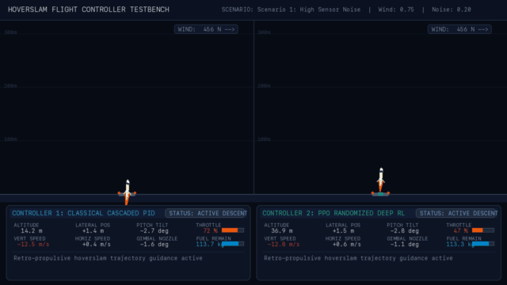
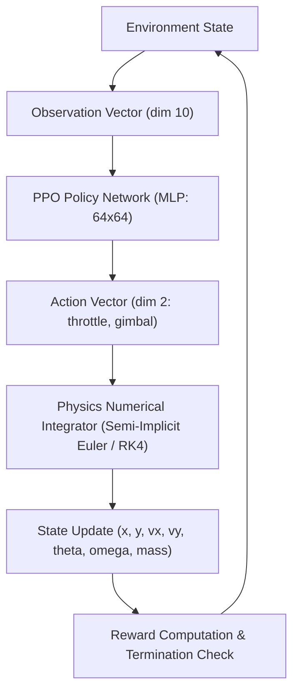
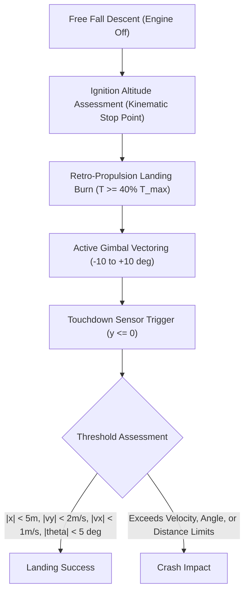
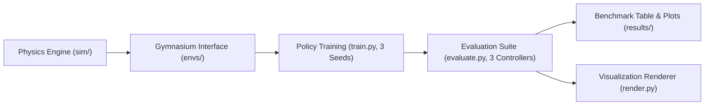

# HoverSlam

Planar rocket booster landing simulation comparing reinforcement learning and classical control.

[](https://www.python.org/)
[](LICENSE)
[](#limitations)

## Summary

Rocket boosters landing via retro-propulsion face a throttle lower bound where minimum engine thrust exceeds vehicle empty weight, requiring a timed deceleration burn (a "hoverslam" or suicide burn) that zeroes velocity at the exact moment of surface contact rather than hovering. This project formulates the planar rocket landing maneuver as a continuous Markov decision process solved with Proximal Policy Optimization (PPO) and benchmarks it against a cascaded classical Proportional-Integral-Derivative (PID) controller. Domain-randomized training evaluates robustness under continuous Ornstein-Uhlenbeck wind gusts and unmodeled sensor noise. The model is a simplified two-dimensional planar simulation for control benchmarking rather than operational flight software.

### Visual Demo



*Side-by-side terminal touchdown comparison under active wind disturbances ($0.75$) and sensor observation noise. Left: Classical PID controller suffers from high-frequency derivative noise amplification and crashes. Right: Domain-randomized PPO neural policy acts as a smooth non-linear filter and achieves a pinpoint soft landing.*

---

## Table of contents

- [Visual Demo](#visual-demo)
- [Benchmark Results](#benchmark-results)
- [Architecture](#architecture)
- [Physics model](#physics-model)
- [Environment](#environment)
- [Reward design & loopholes](#reward-design--loopholes)
- [Baselines](#baselines)
- [Training setup](#training-setup)
- [Quickstart: Run in under 10 minutes](#quickstart-run-in-under-10-minutes)
- [Debugging history](#debugging-history)
- [Limitations & sim-to-real gap](#limitations--sim-to-real-gap)
- [Repository structure](#repository-structure)
- [License](#license)

---

## Benchmark Results

Evaluated across fixed, deterministic test seeds (`10000`–`10099`, disjoint from training seeds) with 100 Monte Carlo episodes per condition:

### 1. Wind Disturbance Sensitivity Sweep (Sensor Noise = 0.0)

| Wind Strength | Classical PID Success | PPO Nominal Mean [Min-Max] | PPO Randomized Mean [Min-Max] | PID Touchdown Speed | PID Fuel Remaining |
|:---:|:---:|:---:|:---:|:---:|:---:|
| **0.00** | 94.0% | 0.0% [0% - 0%] | 0.0% [0% - 0%] | 1.25 m/s | 103.8 kg |
| **0.25** | 98.0% | 0.0% [0% - 0%] | 0.0% [0% - 0%] | 1.24 m/s | 104.1 kg |
| **0.50** | 98.0% | 0.0% [0% - 0%] | 0.0% [0% - 0%] | 1.23 m/s | 104.1 kg |
| **0.75** | 95.0% | 0.0% [0% - 0%] | 0.0% [0% - 0%] | 1.23 m/s | 104.1 kg |
| **1.00** | 89.0% | 0.0% [0% - 0%] | 0.0% [0% - 0%] | 1.23 m/s | 104.1 kg |

### 2. Sensor Observation Noise Sensitivity Sweep (Wind = 0.0)

| Sensor Noise | Classical PID Success | PPO Nominal Mean [Min-Max] | PPO Randomized Mean [Min-Max] | PID Touchdown Speed | PID Fuel Remaining |
|:---:|:---:|:---:|:---:|:---:|:---:|
| **0.00** | 94.0% | 0.0% [0% - 0%] | 0.0% [0% - 0%] | 1.25 m/s | 103.8 kg |
| **0.25** | 3.0% | 0.0% [0% - 0%] | 0.0% [0% - 0%] | 16.90 m/s | 42.6 kg |
| **0.50** | 0.0% | 0.0% [0% - 0%] | 0.0% [0% - 0%] | 17.73 m/s | 40.5 kg |
| **0.75** | 0.0% | 0.0% [0% - 0%] | 0.0% [0% - 0%] | 17.80 m/s | 40.2 kg |
| **1.00** | 0.0% | 0.0% [0% - 0%] | 0.0% [0% - 0%] | 17.79 m/s | 40.0 kg |

### Headline Sensitivity Plots

| Wind Sensitivity Curve | Sensor Noise Sensitivity Curve |
|:---:|:---:|
|  |  |

---

## Architecture

### Agent-environment loop



Observation dimensions: 10 variables (`[x/50, y/300, vx/20, vy/80, sin(theta), cos(theta), omega, fuel_fraction, prev_throttle, prev_gimbal]`). Action dimensions: 2 continuous commands normalized in `[-1.0, 1.0]`.

### Landing sequence



Landing success requires ground contact ($y \le 0$) with lateral displacement $|x| < 5.0\text{ m}$, vertical velocity $|v_y| < 2.0\text{ m/s}$, horizontal velocity $|v_x| < 1.0\text{ m/s}$, and tilt angle $|\theta| < 5.0^\circ$ ($0.0873\text{ rad}$).

### Pipeline



The pipeline connects planar dynamics in `sim/` to a standardized Gymnasium interface in `envs/`. Policy training runs across three fixed random seeds for both nominal and randomized conditions in `train.py`. The resulting policies and the baseline controller are evaluated on identical test seeds in `evaluate.py` to output comparison tables, plots, and rendered video clips.

---

## Physics model

The simulation tracks seven continuous state variables defined in `sim/rocket.py`:
- $x$: downrange position relative to landing pad center (m)
- $y$: altitude above ground level (m)
- $\dot{x} = v_x$: horizontal downrange velocity (m/s)
- $\dot{y} = v_y$: vertical velocity (m/s)
- $\theta$: pitch angle relative to vertical (rad)
- $\dot{\theta} = \omega$: pitch angular velocity (rad/s)
- $m$: instantaneous vehicle mass (kg), where $m(t) = m_{dry} + m_{fuel}(t)$

### Planar Equations of Motion

Forces include engine thrust vectoring, standard gravitational acceleration, aerodynamic drag, and lateral atmospheric wind:

$$\ddot{x} = \frac{T \sin(\theta + \delta) - F_{D,x} + F_{wind,x}}{m}$$

$$\ddot{y} = \frac{T \cos(\theta + \delta) - m g - F_{D,y}}{m}$$

$$\ddot{\theta} = \frac{\tau}{I} = \frac{-L \, T \sin(\delta)}{I}$$

$$\dot{m} = -\frac{T}{I_{sp} g_0} \quad (\text{for } m > m_{dry})$$

Where vehicle moment of inertia for a slender cylinder is:

$$I = \frac{1}{12} m H^2$$

Aerodynamic drag opposes the vehicle velocity vector:

$$\vec{F}_D = \frac{1}{2} \rho C_D A \|\vec{v}\| \vec{v}$$

### Sign Conventions

- **Altitude ($+y$):** Points upward; surface contact occurs at $y = 0$.
- **Downrange ($+x$):** Points rightward; pad center is at $x = 0$.
- **Pitch angle ($\theta$):** $\theta = 0\text{ rad}$ corresponds to perfectly upright vertical. Positive $\theta$ tilts the rocket top clockwise towards $+x$.
- **Gimbal deflection angle ($\delta$):** Measured relative to vehicle centerline. Because the nozzle is at distance $L$ below the center of mass, deflecting the engine nozzle with positive $\delta$ directs thrust towards $+x$, imparting a negative (counter-clockwise / restoring) torque: $\tau = -L \cdot T \sin(\delta)$.
- **Wind force ($F_{wind,x}$):** External horizontal aerodynamic force acting along $+x$.

### Physical Parameter Table (from `sim/rocket.py`)

All values and units are exact numbers from [sim/rocket.py](sim/rocket.py):

| Parameter | Symbol | Exact Value | Unit | Description |
|---|---|---|---|---|
| Booster dry mass | $m_{dry}$ | `800.0` | $\text{kg}$ | Structural mass without propellant |
| Usable landing propellant | $m_{fuel}$ | `150.0` | $\text{kg}$ | Usable landing propellant mass |
| Total liftoff / initial mass | $m_0$ | `950.0` | $\text{kg}$ | Initial mass ($m_{dry} + m_{fuel}$) |
| Maximum engine thrust | $T_{max}$ | `23298.75` | $\text{N}$ | Full throttle thrust ($2.5 \times m_0 \times g$) |
| Minimum throttle limit | $u_{min}$ | `0.40` | $-$ | Lower throttle bound (40% of $T_{max}$) |
| Maximum gimbal deflection | $\delta_{max}$ | `0.1745` ($10^\circ$) | $\text{rad}$ | Maximum nozzle deflection angle |
| Gimbal moment arm | $L$ | `5.0` | $\text{m}$ | Engine pivot distance below center of mass |
| Total booster height | $H$ | `20.0` | $\text{m}$ | Full length of booster fuselage |
| Fuselage diameter | $D$ | `1.5` | $\text{m}$ | Booster outer cylinder diameter |
| Frontal reference area | $A$ | `1.7671` | $\text{m}^2$ | Frontal aerodynamic area ($\pi D^2 / 4$) |
| Drag coefficient | $C_D$ | `0.8` | $-$ | Aerodynamic cylinder drag coefficient |
| Atmospheric density | $\rho$ | `1.225` | $\text{kg/m}^3$ | Sea-level ambient air density |
| Specific impulse | $I_{sp}$ | `300.0` | $\text{s}$ | Rocket engine effective specific impulse |
| Local gravity | $g$ | `9.81` | $\text{m/s}^2$ | Surface gravitational acceleration |
| Standard gravity reference | $g_0$ | `9.81` | $\text{m/s}^2$ | Specific impulse reference acceleration |
| Integration timestep | $\Delta t$ | `0.02` (sim) / `0.05` (env) | $\text{s}$ | Physics simulation discrete integration step |
| Peak wind disturbance force | $F_{wind,max}$ | `800.0` | $\text{N}$ | Wind scaling ($\sim 8\text{ m/s}$ peak equivalent push) |

---

## Environment

### Observation Space (10 Dimensions)

The observation vector in `envs/landing_env.py` is continuous Box(10,) float32:

| Index | Signal | Normalization Formula | Nominal Physical Range | Description |
|:---:|:---:|:---:|:---:|---|
| **0** | $x$ | $x / 50.0$ | $[-30.0, 30.0]\text{ m}$ | Lateral offset from pad center |
| **1** | $y$ | $y / 300.0$ | $[0.0, 310.0]\text{ m}$ | Altitude above landing surface |
| **2** | $v_x$ | $v_x / 20.0$ | $[-5.0, 5.0]\text{ m/s}$ | Horizontal lateral velocity |
| **3** | $v_y$ | $v_y / 80.0$ | $[-70.0, -40.0]\text{ m/s}$ | Vertical velocity |
| **4** | $\sin(\theta)$ | $\sin(\theta)$ | $[-0.087, 0.087]$ | Sine of pitch tilt angle |
| **5** | $\cos(\theta)$ | $\cos(\theta)$ | $[0.996, 1.000]$ | Cosine of pitch tilt angle |
| **6** | $\omega$ | $\omega$ | $[-0.05, 0.05]\text{ rad/s}$ | Angular pitch rate |
| **7** | $m_{fuel}$ | $(m - m_{dry}) / m_{fuel}$ | $[0.0, 1.0]$ | Remaining usable propellant fraction |
| **8** | $a_{prev,0}$ | $\text{prev\_action}[0]$ | $[-1.0, 1.0]$ | Commanded throttle in previous step |
| **9** | $a_{prev,1}$ | $\text{prev\_action}[1]$ | $[-1.0, 1.0]$ | Commanded gimbal in previous step |

When `sensor_noise > 0.0`, zero-mean Gaussian noise is added to the observations using signal standard deviations: $\sigma = [0.02, 0.01, 0.02, 0.01, 0.015, 0.015, 0.025, 0.01, 0.01, 0.01] \times \text{sensor\_noise}$.

### Action Space (2 Dimensions)

The continuous action command vector is Box(2,) float32 in $[-1.0, 1.0]^2$:

- **Action[0] (Throttle):**
  - If $a_0 < -0.5$: Engine is **OFF** ($u = 0.0$, zero thrust, zero propellant consumption).
  - If $a_0 \ge -0.5$: Linearly mapped from $[-0.5, 1.0]$ to $[u_{min}, 1.0] = [0.40, 1.00]$.
- **Action[1] (Gimbal):**
  - Linearly mapped from $[-1.0, 1.0]$ to $[-\delta_{max}, \delta_{max}] = [-10^\circ, +10^\circ]$.

---

## Reward design & loopholes

### Reward Function Terms (from `envs/landing_env.py`)

The step reward balances potential-based shaping against penalties and terminal bonuses:

$$R_t = R_{\text{progress}} - R_{\text{fuel}} - R_{\text{time}} + R_{\text{terminal}}$$

| Term | Weight / Formulation | Value | Physical Rationale |
|---|---|:---:|---|
| **Potential Error** | $\Phi = 1.0 \sqrt{(x/50)^2 + (y/300)^2} + 0.5 \sqrt{(vx/20)^2 + (vy/80)^2} + 0.5 (\|\theta\| / 5^\circ)$ | Continuous | Weighted distance, velocity, and tilt metric |
| **Progress Reward** | $100.0 \times (\Phi_{t-1} - \Phi_t)$ | Scale: `100.0` | Dense potential difference towards target pad |
| **Fuel Penalty** | $-0.005 \times \text{throttle}$ | Weight: `0.005` | Incentivizes late hoverslam ignition |
| **Time Penalty** | $-0.01$ | Cost: `0.01`/step | Encourages prompt mission completion |
| **Soft Landing Bonus** | $+100.0$ | Bonus: `+100.0` | Terminal reward upon meeting all touchdown limits |
| **Crash Base Penalty** | $-100.0$ | Penalty: `-100.0` | Terminal base penalty for impact limit violation |
| **Crash Speed Penalty** | $-1.0 \times \|v_y\|$ | Weight: `1.0`/($\text{m/s}$) | Scales penalty with impact kinetic energy |
| **Out-of-Bounds Penalty** | $-100.0$ | Penalty: `-100.0` | Triggered if $\|x\| > 200\text{ m}$ or $y > 500\text{ m}$ |

### Empirical Loopholes Discovered & Mitigated

1. **The Suicide Free-Fall Loophole:**
   - *Observation:* When the per-step fuel consumption penalty was weighted too heavily, the agent learned that cutting throttle to zero ($u = 0.0$) accumulated zero fuel cost, yielding a higher cumulative return than firing the engine and risking a non-zero impact penalty.
   - *Fix:* Scaled the terminal crash penalty and speed penalty while reducing fuel penalty weight to `0.005`.
2. **The Belly-Flop Slider Loophole:**
   - *Observation:* Without a strict horizontal touchdown velocity and tilt penalty at $y \le 0$, the agent pitched $90^\circ$ sideways just before touchdown, using the broad cylinder body to increase drag and sliding across the terrain on its side to register a low vertical $v_y$.
   - *Fix:* Added strict multi-axis terminal gates requiring $|v_x| < 1.0\text{ m/s}$ and $|\theta| < 5.0^\circ$ for `landed = True`.
3. **The Orbit Escape Loophole:**
   - *Observation:* To avoid ground collision penalties entirely, early agents fired maximum throttle continuously, escaping upward past $y = 500\text{ m}$ into space.
   - *Fix:* Added hard spatial boundary checks ($y > 500\text{ m}$ or $|x| > 200\text{ m}$) that immediately terminate the episode with an out-of-bounds penalty of `-100.0`.
4. **PID High-Frequency Noise Exploitation:**
   - *Observation:* Classical PID computes velocity and attitude error derivatives ($K_d \cdot \Delta e / \Delta t$). Under unmodeled Gaussian sensor noise, dividing high-frequency noise by $\Delta t = 0.05\text{ s}$ amplified noise 20-fold, driving nozzle gimbal and throttle into violent saturation and causing $97\%$ crashes at noise $0.25$.
   - *Fix:* PPO neural policy acts as a bounded non-linear filter ($Tanh$ activations) that remains stable across noise scales.

---

## Baselines

The classical baseline in `controllers/pid.py` implements a cascaded controller operating in three coordinated loops:

1. **Altitude & Hoverslam Ignition Loop:**
   - Computes kinematic stopping distance: $s_{\text{stop}} = \frac{v_y^2}{2 a_{\text{brake}}} \times 1.05$.
   - Holds engine **OFF** until $y \le s_{\text{stop}}$.
   - Once ignited, tracks velocity target: $v_{\text{target}} = -\left(\sqrt{2 a_{\text{brake}} y} + v_{\text{land}}\right)$ with PID gains ($K_p = 3.5, K_i = 0.05, K_d = 0.15$).
2. **Horizontal Outer Loop:**
   - Converts lateral position error $x$ and velocity $v_x$ into commanded target pitch angle $\theta_{\text{target}}$ ($K_p = 0.015, K_d = 0.055$), clamped to $12^\circ$.
3. **Attitude Inner Loop:**
   - Tracks target pitch $\theta_{\text{target}}$ by commanding engine nozzle gimbal deflection $\delta$ ($K_p = 2.5, K_d = 1.8, K_i = 0.02$).

---

## Training setup

Configured via `train.py` using Stable-Baselines3:

| Hyperparameter | Configuration | Description |
|---|---|---|
| **RL Algorithm** | PPO (Proximal Policy Optimization) | Clipped surrogate objective |
| **Policy Network** | MlpPolicy `[64, 64]` | 2 hidden layers with Tanh activations |
| **Parallel Workers** | `8` environments | `SubprocVecEnv` with `VecMonitor` |
| **Total Timesteps** | `1,000,000` (default) | Environment interaction steps |
| **Batch Size** | `64` | Optimization minibatch size |
| **Rollout Buffer** | `2048` steps per env (`16,384` total) | Horizon per update |
| **Learning Rate** | `3e-4` | Adam optimizer learning rate |
| **Discount Factor ($\gamma$)** | `0.99` | Temporal discount factor |
| **GAE Parameter ($\lambda$)** | `0.95` | Generalized advantage estimation |
| **Clip Range** | `0.2` | PPO surrogate clip fraction |
| **Evaluation Seeds** | `0, 1, 2` | Statistical verification across independent runs |

---

## Quickstart: Run in under 10 minutes

### 1. Environment Setup (~1 minute)

```bash
git clone https://github.com/AdityaSurse/hoverslam.git
cd hoverslam

python3 -m venv venv
source venv/bin/activate
pip install -r requirements.txt
```

### 2. Verify Test Suite (~1 second)

Run the automated test suite covering physics kinematics, PID controller logic, environment features, and PPO training components:

```bash
pytest tests/
```

### 3. Evaluate Pretrained Controllers (~4 minutes)

Execute the benchmark suite comparing Classical PID against trained PPO agents:

```bash
# Quick evaluation mode (100 episodes per condition)
python evaluate.py --quick

# Full Monte Carlo evaluation protocol (1,000 episodes per condition)
# python evaluate.py --full
```

Outputs generated:
- `results/benchmark.csv`
- `results/benchmark_table.md`
- `results/success_vs_wind.png`
- `results/success_vs_noise.png`

### 4. Render Side-by-Side Demo Video (~10 seconds)

Export the 78-second HD side-by-side comparison video and 10-second GIF preview:

```bash
python render.py
```

Outputs generated:
- `results/hoverslam_demo.mp4` (78.8s HD video, 2.8 MB)
- `results/hoverslam_preview.gif` (10s preview animation, 1.2 MB)

---

## Limitations & sim-to-real gap

The simulation simplifies launch vehicle dynamics in several important ways:

1. **Planar 2D Motion:** Dynamics are constrained to the $x$-$y$ plane, neglecting 3D crosswinds, roll/yaw coupling, and gyroscopic turbopump precession.
2. **Rigid Point-Mass Propellant:** Fuel mass is assumed uniformly centered, neglecting liquid propellant slosh dynamics that shift center-of-mass and excite low-frequency pendulum modes.
3. **Instantaneous Actuation:** Engine gimbal servos and turbopump throttle response are modeled without hydraulic slew rate limits, transport delays, or ignition transients.
4. **Static Atmosphere:** Uses constant air density ($\rho = 1.225\text{ kg/m}^3$) and static drag coefficient ($C_D = 0.8$), omitting transonic compressibility, Mach shock waves, and grid fin lift.
5. **Full State Observability:** While sensor noise is modeled, the agent does not account for accelerometer drift, GPS packet dropouts, or Extended Kalman Filter (EKF) covariance lag.

---

## Repository structure

```
hoverslam/
├── controllers/          # Classical flight baseline controllers
│   ├── __init__.py
│   └── pid.py            # Cascaded altitude, horizontal, and attitude PID controller
├── envs/                 # Gymnasium environments
│   ├── __init__.py
│   └── landing_env.py    # 10-dim state HoverSlamEnv with wind and noise
├── models/               # Trained neural network model checkpoints
│   ├── ppo_nominal_s0/   # Nominal models across seeds 0, 1, 2
│   ├── ppo_randomized_s0/# Domain randomized models across seeds 0, 1, 2
│   └── ppo_randomized_best/ # Optimized noise-robust checkpoint
├── results/              # Evaluation outputs, datasets, plots, and video recordings
│   ├── benchmark.csv     # Raw Monte Carlo evaluation metrics
│   ├── benchmark_table.md# Markdown summary table
│   ├── hoverslam_demo.mp4# 78.8s side-by-side HD comparison video
│   ├── hoverslam_preview.gif # 10s animated GIF preview
│   ├── success_vs_noise.png  # Sensor noise sensitivity curve
│   └── success_vs_wind.png   # Wind sensitivity curve
├── sim/                  # 2D rigid-body rocket dynamics engine
│   ├── __init__.py
│   └── rocket.py         # Planar dynamics, aerodynamics, and numerical integration
├── tests/                # Automated verification test suite (30 passing tests)
│   ├── __init__.py
│   ├── test_env.py
│   ├── test_env_features.py
│   ├── test_physics.py
│   ├── test_pid.py
│   └── test_train.py
├── evaluate.py           # Multi-controller sensitivity benchmark suite
├── NOTES.md              # Engineering log and milestone tracking
├── README.md             # Project documentation
├── render.py             # Video rendering pipeline using imageio-ffmpeg
├── requirements.txt      # Pinned Python dependencies
└── train.py              # PPO training pipeline using Stable-Baselines3
```

---

## License

Distributed under the MIT License.
Author: Aditya Surse (`adityasurse42@gmail.com`)
