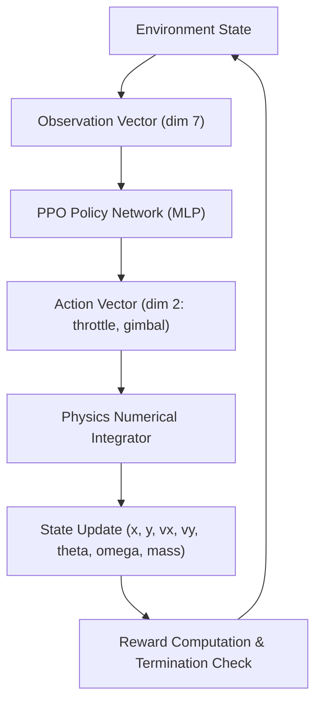
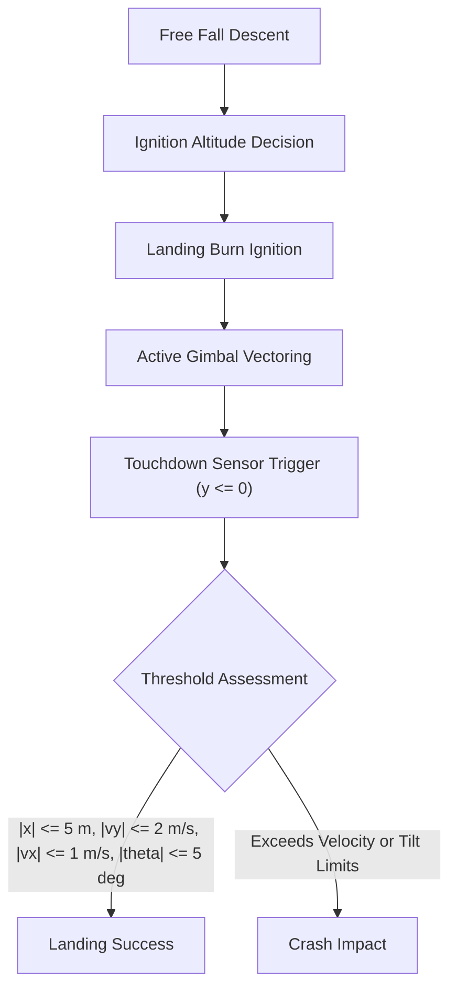
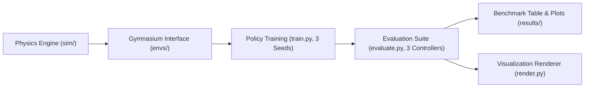

# HoverSlam

Planar rocket booster landing simulation comparing reinforcement learning and classical control.

[](https://www.python.org/)
[](LICENSE)
[](#limitations)

## Summary

Rocket boosters landing via retro-propulsion face a throttle lower bound where minimum engine thrust exceeds vehicle empty weight, requiring a timed deceleration burn that zeroes velocity at the exact moment of surface contact rather than hovering. This project formulates the planar landing maneuver as a continuous Markov decision process solved with Proximal Policy Optimization (PPO) and benchmarks it against a cascaded classical PID controller. Domain-randomized training targets performance under variable wind fields. The model is a simplified two-dimensional planar simulation for control benchmarking rather than operational flight software.

## Table of contents

- [Architecture](#architecture)
- [Physics model](#physics-model)
- [Environment](#environment)
- [Baselines](#baselines)
- [Training setup](#training-setup)
- [Debugging history](#debugging-history)
- [Limitations](#limitations)
- [Execution](#execution)
- [Repository structure](#repository-structure)
- [License](#license)

## Architecture

### Agent-environment loop



Observation dimensions: 7 variables [TODO: Verify observation dimensions in envs/]. Action dimensions: 2 continuous commands (throttle and gimbal angle) [TODO: Verify action bounds in envs/].

### Landing sequence



Landing success requires ground contact ($y \le 0$) with lateral displacement $|x| \le 5\text{ m}$, vertical velocity $|v_y| \le 2.0\text{ m/s}$, horizontal velocity $|v_x| \le 1.0\text{ m/s}$, tilt angle $|\theta| \le 5^\circ$, and angular rate $|\omega| \le 0.1\text{ rad/s}$ [TODO: Confirm exact threshold numbers in envs/].

### Pipeline



The pipeline connects planar dynamics in `sim/` to a standardized Gymnasium interface in `envs/`. Policy training runs across three fixed random seeds for both nominal and randomized conditions in `train.py`. The resulting policies and the baseline controller are evaluated on identical test seeds in `evaluate.py` to output comparison tables, plots, and rendered video clips.

## Physics model

The simulation tracks seven continuous state variables:
- $x$: downrange position relative to the landing pad center (m)
- $y$: altitude above ground level (m)
- $\dot{x} = v_x$: horizontal downrange velocity (m/s)
- $\dot{y} = v_y$: vertical velocity (m/s)
- $\theta$: pitch angle relative to vertical (rad)
- $\dot{\theta} = \omega$: pitch angular velocity (rad/s)
- $m$: instantaneous vehicle mass (kg), where $m(t) = m_{dry} + m_{fuel}(t)$

Planar equations of motion with thrust vectoring and aerodynamic drag:

```latex
\ddot{x} = \frac{T \sin(\theta + \delta) - F_{D,x}}{m}
\ddot{y} = \frac{T \cos(\theta + \delta) - m g - F_{D,y}}{m}
\ddot{\theta} = \frac{-T \, l_e \sin(\delta)}{I}
\dot{m} = -\frac{T}{I_{sp} g_0}
```

Aerodynamic drag opposes the relative velocity vector:

```latex
\vec{F}_D = \frac{1}{2} \rho C_D A \|\vec{v}_{rel}\| \vec{v}_{rel}
```

Sign conventions:
- Altitude $+y$ points upward; surface contact occurs at $y = 0$.
- Downrange $+x$ points rightward; pad center is at $x = 0$.
- Pitch angle $\theta = 0$ corresponds to upright orientation; counter-clockwise rotation is positive.
- Gimbal deflection angle $\delta$ is measured relative to vehicle body centerline; positive counter-clockwise gimbal angle directs thrust rightward, imparting negative (clockwise) pitch torque.

| Parameter | Symbol | Value | Unit | Description |
|---|---|---|---|---|
| Dry mass | $m_{dry}$ | TODO | kg | Booster structure mass |
| Propellant mass | $m_{fuel}$ | TODO | kg | Usable landing propellant mass |
| Maximum thrust | $T_{max}$ | TODO | N | Engine thrust at full throttle |
| Minimum throttle | $u_{min}$ | TODO | - | Minimum throttle limit fraction (e.g. 0.40) |
| Specific impulse | $I_{sp}$ | TODO | s | Effective engine specific impulse |
| Standard gravity | $g_0$ | 9.80665 | $\text{m/s}^2$ | Gravitational acceleration reference |
| Local gravity | $g$ | 9.81 [TODO: Confirm in sim/rocket.py] | $\text{m/s}^2$ | Environmental gravitational acceleration |
| Moment of inertia | $I$ | TODO | $\text{kg}\cdot\text{m}^2$ | Pitch moment of inertia about center of mass |
| Gimbal moment arm | $l_e$ | TODO | m | Distance from gimbal pivot to center of mass |
| Maximum gimbal deflection | $\delta_{max}$ | TODO | rad / deg | Maximum allowable gimbal angle |
| Drag coefficient | $C_D$ | TODO | - | Planar drag coefficient |
| Reference area | $A$ | TODO | $\text{m}^2$ | Frontal aerodynamic area |
| Air density | $\rho$ | 1.225 [TODO: Confirm in sim/rocket.py] | $\text{kg/m}^3$ | Sea-level atmospheric air density |

> [TODO: Fill exact numerical values once sim/rocket.py is created.]

## Environment

### Observation space

| Index | Variable | Description | Range | Unit |
|---|---|---|---|---|
| 0 | $x$ | Horizontal displacement from pad center | TODO | m |
| 1 | $y$ | Altitude above landing surface | TODO | m |
| 2 | $v_x$ | Horizontal downrange velocity | TODO | m/s |
| 3 | $v_y$ | Vertical velocity | TODO | m/s |
| 4 | $\theta$ | Pitch angle relative to vertical | TODO | rad |
| 5 | $\omega$ | Pitch angular velocity | TODO | rad/s |
| 6 | $m_{fuel}$ | Remaining propellant mass | TODO | kg |

> [TODO: Verify observation space bounds in envs/.]

### Action space

| Index | Action | Description | Continuous range | Unit |
|---|---|---|---|---|
| 0 | Throttle command | Engine thrust fraction | [0, 1] [TODO: verify env bounds] | - |
| 1 | Gimbal deflection | Gimbal angle command | [-1, 1] mapped to $[-\delta_{max}, \delta_{max}]$ [TODO: verify] | - |

> [TODO: Verify action space normalization in envs/.]

### Reward structure

| Term | Application condition | Weight / Formulation |
|---|---|---|
| Distance shaping | Every step | $-w_d \sqrt{x^2 + y^2}$ [TODO: check envs/] |
| Velocity penalty | Every step | $-w_v (v_x^2 + v_y^2)$ [TODO: check envs/] |
| Attitude penalty | Every step | $-w_\theta \theta^2 - w_\omega \omega^2$ [TODO: check envs/] |
| Fuel penalty | Every step when engine fires | $-w_f \cdot \text{throttle}$ [TODO: check envs/] |
| Touchdown bonus | Terminal step upon successful landing | $+B_{land}$ [TODO: check envs/] |
| Crash penalty | Terminal step upon velocity or angle violation | $-P_{crash}$ [TODO: check envs/] |

> [TODO: Verify reward weights and equations in envs/.]

### Termination conditions

An episode terminates when any of the following events occur:
- Ground contact: altitude reaches ground level ($y \le 0$), evaluating to success if within limits or crash otherwise.
- Spatial boundary exit: booster exceeds maximum horizontal or vertical boundaries ($|x| > x_{max}$ or $y > y_{max}$) [TODO: verify bounds in envs/].
- Excessive tilt: attitude angle exceeds recovery limits ($|\theta| > \theta_{max}$) [TODO: verify limits in envs/].
- Fuel exhaustion: usable propellant drops to zero ($m_{fuel} \le 0$).
- Timestep limit: episode reaches maximum allowed simulation steps ($t \ge t_{max}$) [TODO: verify step limit in envs/].

## Baselines

The classical baseline uses a cascaded Proportional-Integral-Derivative (PID) architecture operating in three coordinated loops:
- Altitude loop: Calculates required vertical engine thrust by comparing current altitude and descent rate against a target deceleration trajectory.
- Horizontal position loop: Calculates a reference pitch angle $\theta_{ref}$ proportional to lateral displacement error $x$ and velocity $v_x$.
- Attitude loop: Commands the engine gimbal deflection angle $\delta$ to track reference pitch $\theta_{ref}$ while applying derivative damping against angular velocity $\omega$.

The PPO agent is compared against this PID controller because PID represents the industry standard for linear flight control. Decoupled linear PID loops assume independent axes and continuous control authority. A rocket landing engine has a non-zero minimum throttle limit (typically 20% to 40% of maximum thrust), preventing steady hovering and coupling altitude descent to horizontal translation. The comparison tests whether reinforcement learning discovers coordinated non-linear throttle and vectoring profiles that outperform classical linear approximations under severe constraints.

## Training setup

| Parameter | Configuration | Notes |
|---|---|---|
| Algorithm | PPO (Stable-Baselines3) | Clipped surrogate objective |
| Policy architecture | 2-layer MLP (64, 64) [TODO: confirm train.py] | Orthogonal weight initialization |
| Parallel environments | TODO: check train.py | Vectorized simulation workers |
| Total environment steps | TODO: check train.py | Total training timesteps |
| Evaluation seeds | 3 seeds [TODO: confirm list in train.py] | Statistical validation seeds |
| Learning rate | TODO: check train.py | Adam optimizer learning rate |
| Discount factor ($\gamma$) | TODO: check train.py | Temporal reward discount |
| GAE factor ($\lambda$) | TODO: check train.py | Generalized advantage estimation |
| Minibatch size | TODO: check train.py | Optimization minibatch size |
| Entropy coefficient | TODO: check train.py | Exploration bonus coefficient |
| Domain wind range | TODO: check envs/ | Mean wind velocity interval (m/s) |
| Domain mass range | TODO: check envs/ | Vehicle structural mass variation (%) |
| Domain thrust range | TODO: check envs/ | Engine thrust efficiency factor |
| Initial state dispersion | TODO: check envs/ | Starting altitude, lateral offset, velocity intervals |

> [TODO: Lock hyperparameters in table once train.py is implemented.]

## Debugging history

1. Gimbal torque sign inversion: In initial equations of motion, a positive gimbal deflection angle produced positive angular acceleration instead of negative restoring torque. Because the actuator pushed the rocket away from vertical rather than restoring it, the policy quickly destabilized into an uncontrollable spin. Reversing the moment arm sign restored negative feedback stabilization.
2. Fuel reward loophole and free fall: When the per-step fuel consumption penalty was set too high relative to the terminal crash penalty, the agent discovered that cutting engine throttle to zero maximized total episode return. The booster plummeted without firing its engine. Reducing the fuel penalty weight and scaling the terminal crash penalty eliminated this behavior.
3. Sideways touchdown exploitation: In early reward formulations lacking lateral velocity constraints at ground impact, the agent minimized vertical impact speed by pitching horizontal and sliding across the ground on its airframe. Introducing a strict upright angle penalty and dedicated horizontal velocity touchdown threshold forced the agent to land upright on its legs.
4. Premature episode truncation: Setting strict pitch angle termination limits ($|\theta| > 15^\circ$) during early training caused episodes to terminate before the agent could explore the benefit of late retro-propulsion burns. Relaxing early termination limits during initial training allowed the policy to recover from wider angles.

> [TODO: Add further empirical failure modes from NOTES.md as experiments continue.]

## Limitations

The simulation omits several physical characteristics present on actual launch vehicles:
- Planar two-dimensional dynamics: The model simulates motion exclusively in the $x$-$y$ plane, ignoring out-of-plane crosswinds, aerodynamic roll, yaw moments, and gyroscopic forces from rotating turbopump machinery.
- Rigid-body assumption: Propellant mass is modeled as a uniform point or rigid cylinder, omitting liquid propellant slosh dynamics that shift the vehicle center of mass and introduce destabilizing fluid pendulum modes.
- Instantaneous actuator response: Engine gimbal vectoring and throttle response are modeled without hydraulic actuator slew rates, delays, or turbopump spool-up latencies.
- Atmospheric simplifications: Aerodynamic drag uses a static drag coefficient and constant air density rather than Mach-dependent transonic compression curves, atmospheric temperature gradients, or grid fin lift.
- Full state observability: The environment passes clean true state vectors to the agent, omitting sensor noise, accelerometer bias drift, GPS latency, and Kalman filtering estimation lag.

Deploying on real hardware would require extending guidance to three dimensions, modeling actuator response delays, integrating an Extended Kalman Filter for navigation, and adding aerodynamic control surfaces such as cold-gas thrusters and grid fins.

## Execution

Commands run from the project root directory with the virtual environment activated:

```bash
# Set up virtual environment and dependencies
python3 -m venv venv
source venv/bin/activate
pip install -r requirements.txt
```
Expected runtime: 1-2 minutes depending on network download speeds.

```bash
# Run unit test suite
source venv/bin/activate
pytest
```
Expected runtime: < 1 second.

```bash
# Train PPO landing agent
source venv/bin/activate
python train.py
```
Expected runtime: [TODO: Add training runtime once pipeline is implemented].

```bash
# Evaluate benchmark controllers
source venv/bin/activate
python evaluate.py
```
Expected runtime: < 1 second for initial script; [TODO: Update runtime with full Monte Carlo rollout].

```bash
# Render landing visualization
source venv/bin/activate
python render.py
```
Expected runtime: < 1 second for initial script; [TODO: Update runtime with full video generation].

## Repository structure

```
hoverslam/
├── controllers/          # Classical baseline controllers (PID)
│   └── __init__.py
├── envs/                 # Gymnasium landing environments
│   └── __init__.py
├── results/              # Benchmark tables, evaluation plots, and video recordings
│   └── .gitkeep
├── sim/                  # 2D rigid-body rocket dynamics simulation
│   └── __init__.py
├── tests/                # Pytest verification suite
│   └── __init__.py
├── evaluate.py           # Benchmark script comparing PID and PPO agents
├── NOTES.md              # Engineering log and debugging history
├── README.md             # Project documentation
├── render.py             # Trajectory visualization and video rendering
├── requirements.txt      # Pinned Python dependencies
└── train.py              # PPO training pipeline
```

## License

Distributed under the MIT License.
Author: Aditya Surse
