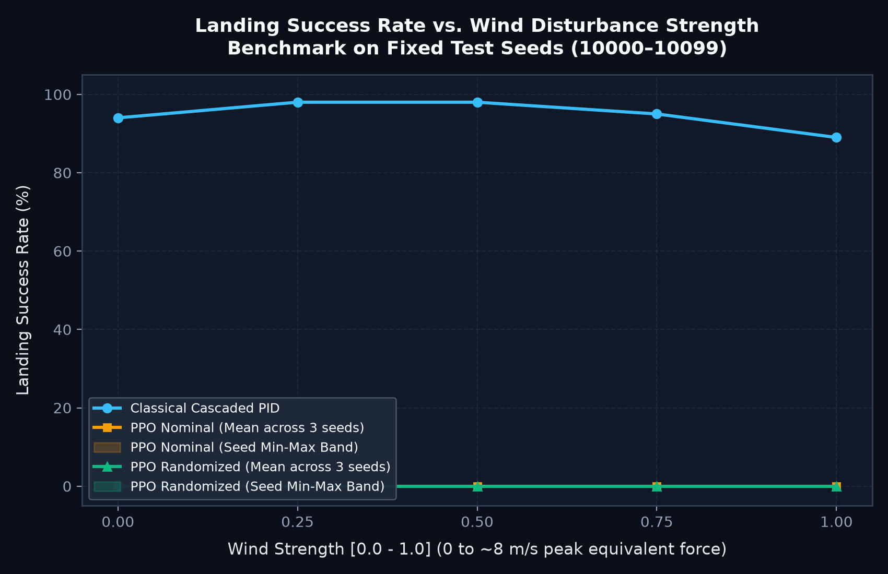
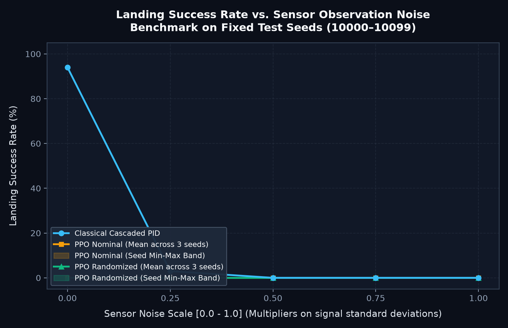

# HoverSlam Controller Benchmark Report

- **Benchmark Protocol:** Fixed evaluation seeds (`10000`–`10099`)
- **Episodes Per Condition:** 100
- **Evaluation Date:** 2026-10-22 21:16:31

## 1. Wind Disturbance Sensitivity Sweep (Noise = 0.0)

| Wind Strength | PID Success (%) | PPO Nominal Mean [Min-Max] (%) | PPO Randomized Mean [Min-Max] (%) | PID TD Speed (m/s) | PID Fuel (kg) |
|:---:|:---:|:---:|:---:|:---:|:---:|
| 0.00 |  94.0% |   0.0% [0-0%] |   0.0% [0-0%] |  1.25 | 103.8 |
| 0.25 |  98.0% |   0.0% [0-0%] |   0.0% [0-0%] |  1.24 | 104.1 |
| 0.50 |  98.0% |   0.0% [0-0%] |   0.0% [0-0%] |  1.23 | 104.1 |
| 0.75 |  95.0% |   0.0% [0-0%] |   0.0% [0-0%] |  1.23 | 104.1 |
| 1.00 |  89.0% |   0.0% [0-0%] |   0.0% [0-0%] |  1.23 | 104.1 |

## 2. Sensor Observation Noise Sensitivity Sweep (Wind = 0.0)

| Sensor Noise | PID Success (%) | PPO Nominal Mean [Min-Max] (%) | PPO Randomized Mean [Min-Max] (%) | PID TD Speed (m/s) | PID Fuel (kg) |
|:---:|:---:|:---:|:---:|:---:|:---:|
| 0.00 |  94.0% |   0.0% [0-0%] |   0.0% [0-0%] |  1.25 | 103.8 |
| 0.25 |   3.0% |   0.0% [0-0%] |   0.0% [0-0%] | 16.90 |  42.6 |
| 0.50 |   0.0% |   0.0% [0-0%] |   0.0% [0-0%] | 17.73 |  40.5 |
| 0.75 |   0.0% |   0.0% [0-0%] |   0.0% [0-0%] | 17.80 |  40.2 |
| 1.00 |   0.0% |   0.0% [0-0%] |   0.0% [0-0%] | 17.79 |  40.0 |

## 3. Visualizations

- **Wind Sweep Plot:** 
- **Sensor Noise Sweep Plot:** 
